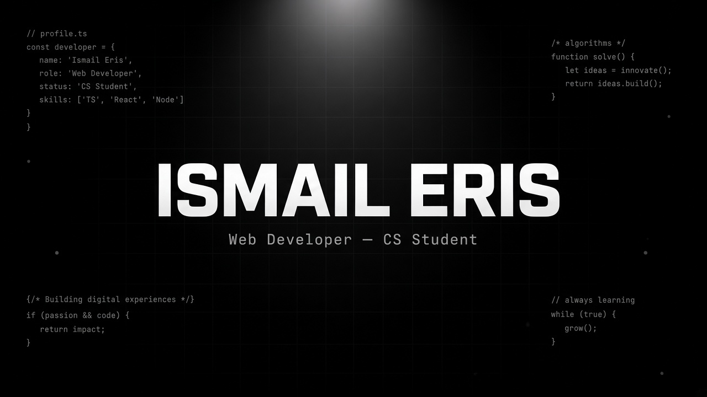
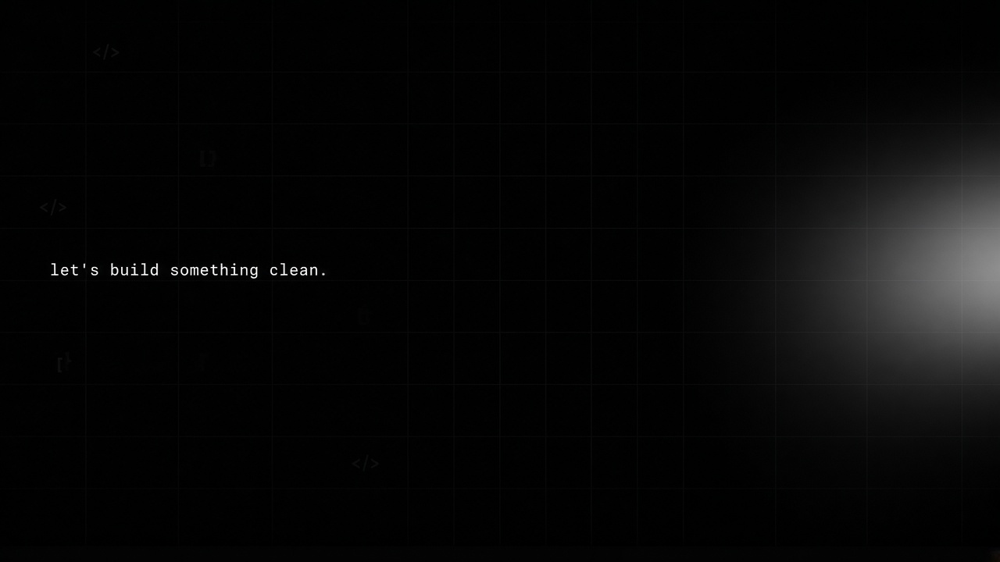

<!-- ======================== HERO ======================== -->
<p align="center">
  
</p>

<p align="center">
  
</p>

<p align="center">
  
  &nbsp;
  <a href="YOUR-LINKEDIN"></a>
  <a href="YOUR-INSTAGRAM"></a>
  <a href="mailto:your@email.com"></a>
</p>

<p align="center">
  
</p>

<!-- ======================== ABOUT ======================== -->
### `›` about

```ts
const ismail = {
  name: "İsmail Eriş",
  role: "Web Developer",
  focus: ["Computer Science", "Web", "Security"],
  stack: ["HTML", "CSS", "JavaScript", "Python"],
  currently: "building clean, fast interfaces",
  motto: "less noise, more signal",
};
```

> Minimal arayüzler, hızlı siteler ve okunabilir kod. — *İsmail*

<p align="center">
  
</p>

<!-- ======================== STACK ======================== -->
### `›` stack

<p align="center">
  
  
  
  
  
  
  
</p>

<p align="center">
  
</p>

<p align="center">
  
</p>

<!-- ======================== STATS ======================== -->
### `›` stats

<p align="center">
  
</p>

<table align="center">
  <tr>
    <td></td>
    <td></td>
  </tr>
  <tr>
    <td></td>
    <td></td>
  </tr>
</table>

<p align="center">
  
</p>

<p align="center">
  
</p>

<!-- ======================== CONTRIBUTIONS ======================== -->
### `›` contributions

<p align="center">
  <picture>
    <source media="(prefers-color-scheme: dark)" srcset="https://raw.githubusercontent.com/ismailerisx/ismailerisx/output/github-contribution-grid-snake-dark.svg" />
    <source media="(prefers-color-scheme: light)" srcset="https://raw.githubusercontent.com/ismailerisx/ismailerisx/output/github-contribution-grid-snake.svg" />
    
  </picture>
</p>

<!-- ======================== FOOTER ======================== -->
<p align="center">
  
</p>
